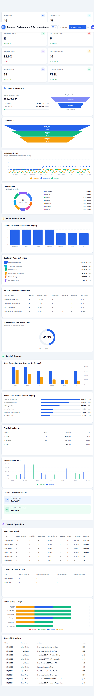

# Business Analytics Dashboard

A responsive business performance dashboard for tracking leads, quotations, deals, revenue, collections, and team operations. The interface brings sales metrics and interactive charts together with date-range and team filters.



## Features

- **At-a-glance KPIs** for leads, conversion, quotations, deals, revenue, and collections.
- **Lead analytics** with a three-stage funnel, lead-source breakdown, and daily trend.
- **Quotation and revenue charts** grouped by service, category, and date.
- **Operations views** for order progress, team performance, and recent activity.
- **Interactive filters** for date range, department, and team member.
- **Expandable dashboard cards** with keyboard support and outside-click dismissal.
- **Responsive layouts** for desktop, tablet, and mobile screens.
- **CSV exports** for dashboard summaries and filtered records.

## Tech stack

- React 19
- Vite 8
- Recharts
- Sass
- date-fns
- Lucide React

## Run locally

Requirements: Node.js 20.19+ (or 22.12+) and npm.

```bash
git clone <your-github-repository-url>
cd business-analytics-dashboard
npm install
npm run dev
```

Open the local URL printed by Vite, usually `http://localhost:5173`.

## Available commands

| Command | Description |
| --- | --- |
| `npm run dev` | Start the local development server |
| `npm run build` | Create the production build in `dist/` |
| `npm run preview` | Preview the production build locally |
| `npm test` | Run the dashboard analytics and data-integrity checks |
| `npm run lint` | Run ESLint |

## Deploy

The production site is a static Vite app. Push the project to GitHub, then import the repository into **Vercel** or **Netlify**:

| Setting | Value |
| --- | --- |
| Build command | `npm run build` |
| Output directory | `dist` |
| Install command | `npm install` |

Both platforms can redeploy automatically whenever you push changes to the connected GitHub branch. To build locally, run `npm run build` and publish the generated `dist/` directory to any static hosting provider.

## Project structure

```text
src/
  components/     Shared layout, cards, tables, and chart components
  context/        Dashboard filters and shared state
  data/           Sample business records
  features/       Dashboard sections and analytics views
  services/       KPI and chart data calculations
  styles/         Global styles, theme variables, and responsive layouts
  utils/          Date, formatting, and analytics helpers
public/           Static assets and dashboard preview image
scripts/          Data and analytics verification tests
```

## Data

The dashboard currently uses deterministic sample records stored in `src/data/`. Filters and charts calculate their results from these records in the browser; no API credentials or backend service are required.
